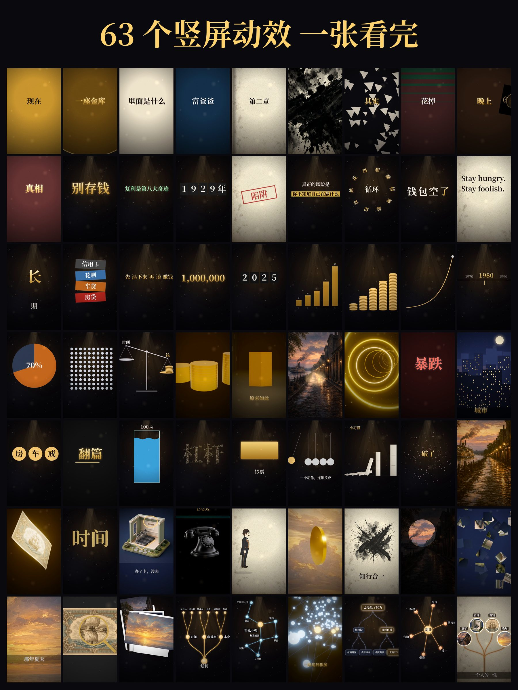
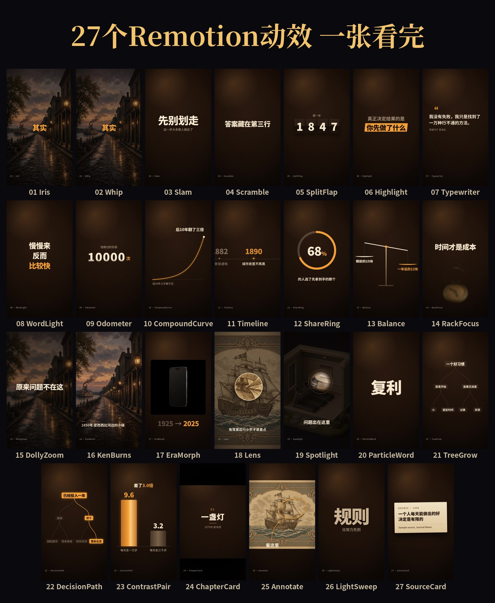

# vibe-fx

[中文](README.md) | **English**

**Generated-image × code motion effects for vertical (9:16) short videos.**
An AI coding agent writes the animation code, an image model supplies real-looking textures, and a headless browser renders every frame into a 1080×1920 video, with automatic QA.


<p align="center">            </p>

- **63 effect presets** in one file (`engine/effects/fx.js`): transitions, kinetic text, numbers, camera moves, morph/physics, image-gen × code, tree/node graphs. See the [effect index](docs/effect-library.md) and the [gallery](https://ai-martin-lau.github.io/vibe-fx/).
- **Generated images as material**, not just backgrounds: textures on 3D props, depth-plate dollies, image → particles → word, era morphs, cutout puppets.
- **Short-video pacing built in**: one `rhythm.json` drives picture and music, with rules for text speed, change density and ambient motion ([playbook](docs/playbook.md)).
- **Automatic QA**: dead fades, static gaps, motion energy, read time, audio balance.

## Gallery
All 63 effects on one sheet (one frame per effect):

<p align="center"></p>


## Remotion edition (2026-11-04)
`remotion/` holds 27 Remotion components (22 remade, 5 new) in one cinema look: warm grade, film grain, vignette, one sans font, one amber accent. Decisions: [docs/remotion-remake.md](docs/remotion-remake.md)。

<p align="center"></p>

```bash
cd remotion && npm install
npx remotion studio src/index.ts                          # preview
npx remotion render src/index.ts ContrastPair out/a.mp4   # render one
./render-stills.sh                                        # all demos + overview
```

## Requirements
- Python 3.10+ with `pip install playwright numpy scipy soundfile pillow` and `python3 -m playwright install chromium`
- ffmpeg
- Font **Noto Serif CJK SC** (Linux: `fonts-noto-cjk` / `fonts-noto-cjk-extra`; macOS: `brew install --cask font-noto-serif-cjk-sc`). For a quick test without it: `VIBE_ALLOW_FONT_FALLBACK=1`.

## Quick start
```bash
git clone https://github.com/ai-martin-lau/vibe-fx && cd vibe-fx
examples/effect-library/one.sh k_slam        # 2.5 s clip -> examples/effect-library/out/test/test.mp4
examples/effect-library/one.sh r_treeGrow
```
Effects starting with `g_` (and a few others marked 🖼 in the index) use generated images. Example images ship in `examples/effect-library/img/`, and the prompts are in the index so you can make your own. Pure-code effects need no images.

Full catalog film: `cd examples/effect-library && python3 gen.py && ../../engine/make.sh .`

## Make your own film
```bash
engine/newfilm.sh films/my-film              # copy templates/film
python3 engine/rhythm.py films/my-film       # check the rhythm table
engine/make.sh films/my-film --test 10       # 10 s test
engine/make.sh films/my-film                 # final + cover + overview + QA report
```
Use an effect in `scene.html`:
```html
<script src="../../engine/effects/fx.js"></script>
<script>
FXI('img/');                    // preload images used by g_* effects
FXP.k_slam={s:'Stop saving'};   // parameters
S.push({id:'hook',draw(t,lt){FXR.k_slam.draw(lt,2.5,t)}});
</script>
```

## Add an effect
1. Register it with `FX('<cat>_<name>', ...)` in `engine/effects/fx.js`; it becomes `FXR.<id>.draw(lt,D,t)` (`lt` = local time, `D` = duration). Defaults go in `FXP.<id>`, images via `FXI`.
2. `gen.py` picks it up automatically; add a row to `docs/effect-library.md`.
3. Run `examples/effect-library/one.sh <id>` and check the QA report.

## Use as a Claude Code plugin
The repo is a plugin marketplace (`.claude-plugin/marketplace.json` points to `plugin/`, skill `plugin/skills/vibe-fx/SKILL.md`):
`/plugin marketplace add ai-martin-lau/vibe-fx` then `/plugin install vibe-fx@vibe-fx`.

## Layout
`engine/` renderer, audio, QA · `engine/effects/fx.js` effect library · `examples/` effect-library, image-code-demo, anim-demo · `templates/` new-film template · `docs/` playbook, effect index, research, gallery

## License
[MIT](LICENSE), © 2026 ai-martin-lau. Third-party code and notices are listed in [THIRD_PARTY_NOTICES.md](THIRD_PARTY_NOTICES.md).
