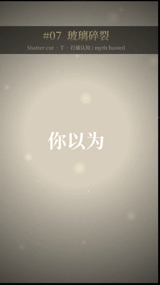
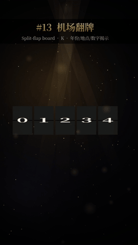
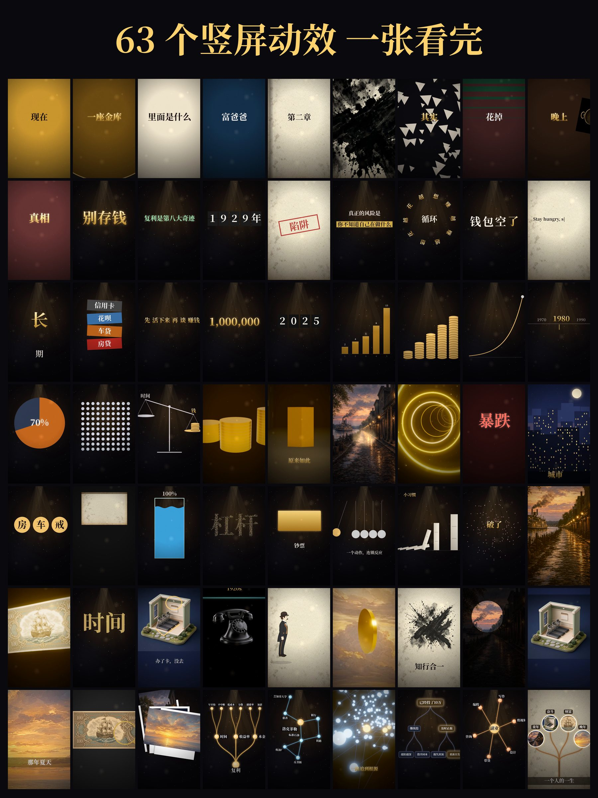

# vibe-fx

**中文** | [English](README.en.md)

**给竖屏（9:16）短视频用的「生图 × 代码」动效库。**
AI 写动画代码，生图模型提供真实质感的素材，无头浏览器逐帧渲染出 1080×1920 的视频，最后自动质检。


<p align="center">            </p>

- **63 个动效预设**，都在一个文件里（`engine/effects/fx.js`）：转场、动态字、数字、运镜、变形与物理、生图 × 代码、树状节点。见[动效索引](docs/effect-library.md)和[在线画廊](https://ai-martin-lau.github.io/vibe-fx/)。
- **生图不只是背景**：贴到 3D 道具上当纹理、伪深度推镜、图片碎成粒子再聚成字、跨时代变形、剪纸木偶。
- **内置短视频节奏**：一张 `rhythm.json` 同时驱动画面和配乐，并规定了字的出现速度、画面变化密度和全片底层微动（见 [playbook](docs/playbook.md)）。
- **自动质检**：检查拖沓的淡入淡出、静止段、运动能量、读字时间和低频平衡。

## 画廊
全部 63 个动效一张图看完（每格是一个效果的一帧，原图在 `docs/previews/all-effects.jpg`）：

<p align="center"></p>

## 环境要求
- Python 3.10+，运行 `pip install playwright numpy scipy soundfile pillow` 和 `python3 -m playwright install chromium`
- ffmpeg
- 字体 **Noto Serif CJK SC**（Linux 装 `fonts-noto-cjk` / `fonts-noto-cjk-extra`；macOS 用 `brew install --cask font-noto-serif-cjk-sc`）。没装字体想先试试，可以设 `VIBE_ALLOW_FONT_FALLBACK=1`。

## 快速开始
```bash
git clone https://github.com/ai-martin-lau/vibe-fx && cd vibe-fx
examples/effect-library/one.sh k_slam        # 2.5 秒片段，输出到 examples/effect-library/out/test/test.mp4
examples/effect-library/one.sh r_treeGrow
```
以 `g_` 开头的效果（以及索引里标 🖼 的几个）要用生成图片。示例图已经放在 `examples/effect-library/img/`，索引里也附了提示词，可以自己生成替换。纯代码效果不需要图片。

渲染完整目录片：`cd examples/effect-library && python3 gen.py && ../../engine/make.sh .`

## 做自己的片子
```bash
engine/newfilm.sh films/my-film              # 从 templates/film 复制模板
python3 engine/rhythm.py films/my-film       # 检查节奏表
engine/make.sh films/my-film --test 10       # 先出 10 秒测试
engine/make.sh films/my-film                 # 成片 + 封面 + 总览图 + 质检报告
```
在 `scene.html` 里调用一个效果：
```html
<script src="../../engine/effects/fx.js"></script>
<script>
FXI('img/');                    // 预加载 g_* 效果要用的图片
FXP.k_slam={s:'先别划走'};       // 参数
S.push({id:'hook',draw(t,lt){FXR.k_slam.draw(lt,2.5,t)}});
</script>
```

## 新增一个效果
1. 在 `engine/effects/fx.js` 里用 `FX('<类别>_<名字>', ...)` 注册（参照现有条目），之后就能用 `FXR.<id>.draw(lt,D,t)` 调用（`lt` 是镜头内时间，`D` 是时长）。默认参数写在 `FXP.<id>`，图片用 `FXI` 加载。
2. `gen.py` 会自动收录它，再在 `docs/effect-library.md` 里加一行说明。
3. 运行 `examples/effect-library/one.sh <id>`，看质检报告。

## 作为 Claude Code 插件使用
仓库本身就是一个插件市场（`.claude-plugin/marketplace.json` 指向 `plugin/`，技能文件是 `plugin/skills/vibe-fx/SKILL.md`）：
先运行 `/plugin marketplace add ai-martin-lau/vibe-fx`，再运行 `/plugin install vibe-fx@vibe-fx`。

## 目录结构
`engine/` 渲染、音频、质检 · `engine/effects/fx.js` 动效库 · `examples/` 动效目录、生图×代码示例、动画示例 · `templates/` 新片模板 · `docs/` playbook、动效索引、研究笔记、画廊

## 许可证
[MIT](LICENSE)，© 2026 ai-martin-lau。用到的第三方代码及其声明见 [THIRD_PARTY_NOTICES.md](THIRD_PARTY_NOTICES.md)。
